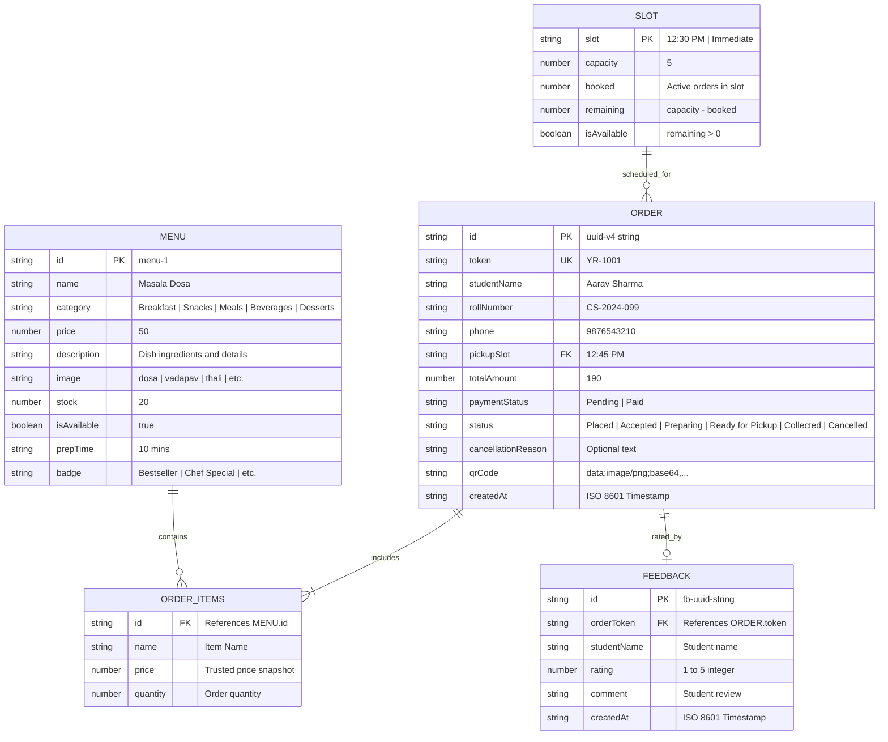

# SMART CANTEEN & MESS MANAGEMENT SYSTEM
## Course / Capstone Engineering Project (CEP) Submission Report

---

### **Project Metadata**
* **Project Title:** Smart Canteen & Mess Management System with Autonomous Voice AI Copilot (Yulu AI)
* **Academic Level:** Undergraduate Engineering Course Project / Capstone Project (CEP)
* **Domain:** Web Engineering, Distributed Systems, Speech Processing, Kitchen Automation
* **Technology Stack:** Node.js, Express.js, Vanilla HTML5/CSS3/JavaScript (ES6+), Web Speech API, QRCode.js
* **Backend Database:** Local JSON File-Based Database (`data/canteen_db.json`)
* **Verification Status:** 34 / 34 Integration Tests Passing (100% Pass Rate)
* **Repository Path:** `d:\Mess Management System`

---

## 1. Project Abstract

In higher educational institutions and corporate campuses, cafeteria and mess facilities experience extreme demand surges during designated 15 to 30-minute recess intervals. Conventional counter-ordering paradigms suffer from prolonged queues, manual cash transaction delays, unpredictable kitchen preparation loads, and meal collection chaos, often forcing students to skip meals or arrive late to lectures.

The **Smart Canteen & Mess Management System** is a production-grade, full-stack web application architected to eliminate cafeteria congestion through slot-throttled pre-ordering, live kitchen pipeline synchronization, and an autonomous conversational voice assistant (**Yulu AI**). The platform empowers students to browse categorized menus with real-time stock levels, schedule meal pickups across capacity-governed time slots (5 orders/slot), and receive cryptographically verified alphanumeric tokens (`#YR-XXXX`) with scannable base64 QR code vouchers. 

For cafeteria staff, a dedicated Kitchen Kiosk provides a five-stage sequential order processing pipeline (`Placed` $\rightarrow$ `Accepted` $\rightarrow$ `Preparing` $\rightarrow$ `Ready for Pickup` $\rightarrow$ `Collected`) accompanied by independent counter payment tracking (`Pending` / `Paid`). The Administrative Portal delivers real-time business intelligence, revenue tracking, inventory CRUD operations, and student review aggregation. 

Additionally, the system features **Yulu AI**, an integrated voice-activated autonomous ordering copilot leveraging browser-native speech synthesis and recognition. Yulu AI employs a conversational reasoning engine that handles budget optimization (under ₹50, ₹100, ₹150), rush meal identification (<5 mins prep), post-workout nutritional breakdowns (~24g protein), and 1-shot checkout. Automated verification via 14 comprehensive test suites across 34 assertions validates that the system strictly enforces server-authoritative pricing, negative stock prevention, atomic stock restoration upon early cancellation, and role-based access control.

---

## 2. Problem Statement and Motivation

### 2.1 The Problem
Campus cafeterias operate under a unique operational bottleneck characterized by extreme, bursty footfall:
1. **Queue Bottlenecks:** Hundreds of students arrive simultaneously within a 20-minute break. Physical queuing at payment and collection counters consumes 15–20 minutes, leaving minimal time to consume food.
2. **Food Wastage & Stockout Asymmetry:** Kitchen operators lack advance visibility into incoming dish demand. Consequently, perishable items are either overcooked (leading to food waste) or exhausted prematurely (causing student dissatisfaction).
3. **Counter Cash & Payment Delays:** Manual cash handling and verifying individual UPI payments at crowded counters slow throughput to 1 transaction per 45–60 seconds.
4. **Kitchen Operational Chaos:** Verbal order communication between cashier and kitchen staff results in missed orders, incorrect dish preparation, and untracked token allocation.
5. **Lack of Dietary & Budget Guidance:** Students facing limited meal budgets or gym nutrition requirements lack quick decision-making tools during high-stress recess rushes.

### 2.2 Motivation
The motivation of this project is to create an accessible, zero-friction, hardware-agnostic digital ecosystem for college cafeterias that requires no external app store downloads. By transforming cafeteria operations into an asynchronous pre-order pipeline with automated token slots, students can secure their meal before lecture dismissal, walk directly to collection Counter 2, scan their QR voucher, and pick up their freshly prepared meal in under 30 seconds.

---

## 3. Objectives and Project Scope

### 3.1 Primary Objectives
1. **Slot-Throttled Pre-Ordering:** Implement scheduled pickup slots with a server-enforced limit (`SLOT_CAPACITY = 5`) to distribute physical counter arrivals evenly.
2. **Server-Authoritative Pricing & Stock Integrity:** Guarantee that order totals are calculated strictly using trusted database values, rejecting client price spoofing and preventing negative inventory.
3. **Five-Stage Live Kitchen Lifecycle:** Provide real-time status progression (`Placed` $\rightarrow$ `Accepted` $\rightarrow$ `Preparing` $\rightarrow$ `Ready for Pickup` $\rightarrow$ `Collected`) with millisecond timestamps and background polling.
4. **Conditional Order Cancellation with Stock Restoration:** Permit order cancellation strictly while food is not yet cooking (`Placed` or `Accepted`); automatically restore reserved portions back to stock upon cancellation.
5. **QR Code Digital Meal Token:** Generate a high-contrast base64 QR code and token string for instant physical counter verification.
6. **Conversational Voice AI Copilot (Yulu AI):** Implement an intelligent, in-browser voice assistant capable of budget reasoning, nutritional macro calculations, time-of-day contextual suggestions, and 1-shot voice ordering.
7. **Role-Based Operational Views:** Provide dedicated interfaces for Students, Kitchen Staff, and Administrators without external framework bloat.

### 3.2 Project Scope: Implemented vs. Out-of-Scope

| Dimension | Implemented in Current System (Actual Codebase) | Out-of-Scope (Future Enhancements) |
| :--- | :--- | :--- |
| **User Roles** | Student, Kitchen Staff, and Administrator. | Multi-canteen tenant isolation. |
| **Ordering** | Pre-ordering with slot selection, cart stepper, instant 1-shot voice checkout. | Group/bulk ordering for campus clubs. |
| **Payment** | Cash-at-pickup & Counter UPI verification with dual status (`Pending`/`Paid`). | Direct payment gateway (Razorpay/Stripe API). |
| **Voice AI** | Yulu AI voice copilot with Web Speech API & conversational intelligence engine. | Cloud LLM integration (OpenAI/Gemini API calls). |
| **Verification** | Base64 QR code generator & token lookup endpoint (`/api/orders/:token/qr`). | Physical barcode hardware scanner integration. |
| **Database** | Persistent file-based atomic JSON storage (`data/canteen_db.json`). | Distributed SQL/NoSQL cluster (PostgreSQL/MongoDB). |
| **Language** | English and Hinglish conversational voice parsing. | Full regional localization (e.g. Marathi UI). |

---

## 4. System Architecture Description

### 4.1 Architectural Overview
The system follows a lightweight, modular **Client-Server Architecture** adhering to RESTful principles. The presentation tier communicates with the Node.js backend using asynchronous `fetch()` API calls with JSON payloads and role-identifying HTTP headers (`x-user-role`).

```
                              ┌─────────────────────────────────────────┐
                              │            CLIENT BROWSER               │
                              │  ┌───────────────────────────────────┐  │
                              │  │    Single Page Application (SPA)  │  │
                              │  │   (index.html, style.css, app.js) │  │
                              │  └─────────────────┬─────────────────┘  │
                              │                    │                    │
                              │    ┌───────────────┴───────────────┐    │
                              │    │                               │    │
                              │ ┌──▼──────────┐         ┌──────────▼──┐ │
                              │ │ Yulu AI     │         │ Web Speech  │ │
                              │ │ Voice Engine│ ◄─────► │ API (STT/   │ │
                              │ │ & Reasoning │         │ TTS Synthesis)│
                              │ └─────────────┘         └─────────────┘ │
                              └────────────────────┬────────────────────┘
                                                   │ HTTP / REST (JSON)
                                                   │ Headers: x-user-role
                                                   ▼
                              ┌─────────────────────────────────────────┐
                              │           NODE.JS BACKEND (server.js)   │
                              │  ┌───────────────────────────────────┐  │
                              │  │ Express REST API & Middleware     │  │
                              │  │ (Role Auth, Validation, Errors)   │  │
                              │  └─────────────────┬─────────────────┘  │
                              │                    │                    │
                              │  ┌─────────────────┼─────────────────┐  │
                              │  │                 │                 │  │
                              │ ┌▼──────────────┐ ┌▼──────────────┐ ┌▼─┐│
                              │ │Pricing & Stock│ │Slot Capacity  │ │QR││
                              │ │Calculator     │ │Manager        │ │  ││
                              │ └───────────────┘ └───────────────┘ └──┘│
                              └────────────────────┬────────────────────┘
                                                   │ Atomic File I/O
                                                   │ fs.readFileSync / writeFileSync
                                                   ▼
                              ┌─────────────────────────────────────────┐
                              │      DATA LAYER (canteen_db.json)       │
                              │  • menu[]        • orders[]             │
                              │  • slots[]       • feedback[]           │
                              └─────────────────────────────────────────┘
```

### 4.2 Data Flow Lifecycle
1. **Menu Discovery:** Student loads the SPA $\rightarrow$ Client requests `GET /api/menu` $\rightarrow$ Backend reads `canteen_db.json` $\rightarrow$ Client renders cards with stock badges, prep times, and dish tags.
2. **Order Placement:**
   - Student selects items and pickup slot (e.g., `12:45 PM`).
   - Client sends `POST /api/orders` with student credentials and item IDs.
   - Server validates student name, roll number, and items array.
   - Server checks slot capacity (`SLOT_CAPACITY <= 5`).
   - Server computes total amount **exclusively from database prices** (client price is ignored).
   - Server verifies each item has sufficient stock (`stock >= qty`), then atomically decrements stock.
   - Server generates sequential token (`#YR-1045`) and base64 PNG QR code via `qrcode`.
   - Order is stored in `data/canteen_db.json` with status `Placed` and `paymentStatus: "Pending"`.
3. **Staff Preparation Pipeline:**
   - Kitchen staff dashboard polls `GET /api/orders` every 4 seconds.
   - Staff clicks `Accept Order` $\rightarrow$ `PATCH /api/orders/:id/status` (status becomes `Accepted`).
   - Staff clicks `Start Preparing` $\rightarrow$ status becomes `Preparing`. At this instant, order cancellation is locked.
   - Staff clicks `Mark Cash Received` $\rightarrow$ `PATCH /api/orders/:id/payment` (`paymentStatus: "Paid"`).
   - Staff clicks `Mark Ready for Pickup` $\rightarrow$ status becomes `Ready for Pickup`.
   - Staff hands over tray and clicks `Hand Over & Collected` $\rightarrow$ status becomes `Collected`.
4. **Live Synchronization:** Student tracking view polls `GET /api/orders/:token` $\rightarrow$ Stepper visual updates dynamically from Step 1 through Step 5 with exact timestamps.
5. **Rating Submission:** Upon collection, student submits feedback via `POST /api/feedback` $\rightarrow$ Aggregated average rating updates on the public review view and admin dashboard.

---

## 5. Database Design and Schema Specification

The application employs a centralized, single-source-of-truth document database stored in `data/canteen_db.json`. Below is the complete entity design and relational schema.

### 5.1 Entity Relationship Diagram (ERD)



### 5.2 Data Dictionary

| Collection | Field | Type | Constraint | Description |
| :--- | :--- | :--- | :--- | :--- |
| `menu` | `id` | String | PK, Unique | Unique identifier (e.g. `menu-1`, `menu-5`) |
| `menu` | `name` | String | Required | Name of the canteen food item |
| `menu` | `category` | String | Required | Enum: `Breakfast`, `Snacks`, `Meals`, `Beverages`, `Desserts` |
| `menu` | `price` | Number | $\ge 0$ | Unit price in INR (₹) |
| `menu` | `stock` | Number | $\ge 0$ | Available inventory portions |
| `menu` | `isAvailable` | Boolean | Required | Flag indicating whether item can be ordered |
| `menu` | `prepTime` | String | Required | Kitchen prep duration estimate (e.g. `5 mins`) |
| `orders` | `id` | String | PK, Unique | Unique order identifier |
| `orders` | `token` | String | Unique | Alphanumeric token (format: `YR-XXXX`) |
| `orders` | `studentName` | String | Required | Full name of the student |
| `orders` | `rollNumber` | String | Required | Campus college roll / registration number |
| `orders` | `pickupSlot` | String | Required | Target pickup slot validated against `AVAILABLE_SLOTS` |
| `orders` | `items` | Array | Min 1 item | Array of `{ id, name, price, quantity }` objects |
| `orders` | `totalAmount` | Number | Computed | Grand total calculated strictly from database prices |
| `orders` | `status` | String | Enum | `Placed`, `Accepted`, `Preparing`, `Ready for Pickup`, `Collected`, `Cancelled` |
| `orders` | `paymentStatus`| String | Enum | `Pending` (default for cash), `Paid` (counter verified) |
| `orders` | `qrDataUrl` | String | Base64 PNG | Embedded base64 QR code image |
| `orders` | `stageTimestamps`| Object | Timestamps | Records ISO timestamps for every stage transition |
| `feedback`| `id` | String | PK, Unique | Feedback identifier |
| `feedback`| `orderToken` | String | FK | Associated order token |
| `feedback`| `rating` | Number | 1 to 5 | Star rating |
| `feedback`| `comment` | String | Optional | Student comments |

---

## 6. Detailed Module Descriptions

### 6.1 Student Pre-Ordering & Tracking Module
* **Meal of the Moment Engine:** Dynamically renders dynamic greetings based on campus local time (*e.g. "Good Morning! Breakfast Specials" before 11:30 AM; "Lunch & Thali Specials" between 11:30 AM – 3:30 PM*).
* **Interactive Menu & Category Filtering:** Real-time dish browsing with visual badges (*Bestseller*, *Chef Special*, *Student Fav*), stock status indicators (*● In Stock*, *● Few Left*, *● Sold Out*), and item search.
* **Slide-Over Cart Drawer:** Real-time subtotal computation, quantity increment/decrement controls bounded by item maximum available stock, pickup slot selection with remaining quota counters (*e.g., "12:45 PM (4 spots left)"*), and instant order placement.
* **Digital Token & QR Voucher Modal:** Displays token `#YR-XXXX`, pickup slot, payment instructions (Counter 2 Cash/UPI), and an embedded scannable QR code.
* **Live 5-Stage Stepper Tracker:** Visual pipeline tracking (`Placed` $\rightarrow$ `Accepted` $\rightarrow$ `Preparing` $\rightarrow$ `Ready for Pickup` $\rightarrow$ `Collected`) with dynamic timestamps, animated pulses, and background polling every 4 seconds.
* **Safe Order Cancellation:** Student can cancel an active order with one click if status is `Placed` or `Accepted`. Food preparation lock rejects cancellation once status reaches `Preparing`.
* **Student Review & Star Rating:** Collects 1–5 star ratings and textual reviews once an order status is marked `Collected`.

### 6.2 Canteen Kitchen Staff Kiosk Module
* **Real-Time Order Queue:** Chronologically sorted list of incoming student orders showing token number, student name, roll number, order items, and pickup slot.
* **Filter Tabs:** Categorize queue by status (`All Active`, `Placed`, `Accepted`, `Preparing`, `Ready`, `Collected`).
* **Sequential Stage Progression:** Four action buttons strictly enforce allowed state transitions:
  1. `Accept Order 👍`: Moves `Placed` $\rightarrow$ `Accepted`.
  2. `Start Preparing 🍳`: Moves `Accepted` $\rightarrow$ `Preparing` (locks cancellation).
  3. `Mark Ready for Pickup 🔔`: Moves `Preparing` $\rightarrow$ `Ready for Pickup`.
  4. `Hand Over & Collected 🎉`: Moves `Ready` $\rightarrow$ `Collected`.
* **Independent Payment Verification:** Dedicated toggle button (`Mark Cash Received (Paid 💵)`) allows counter staff to record receipt of physical cash or spot UPI transfers.
* **Kitchen Staff Cancellation:** Allows kitchen staff to cancel orders in early stages with automatic inventory restoration.

### 6.3 Administrator Analytics & Inventory Module
* **Executive KPI Cards:** Real-time summaries displaying Today's Revenue (divided into Cash Paid vs Pending), Total Order Count, Active Kitchen Queue, and Average Student Rating.
* **Visual Analytics Charts:** Dynamic CSS bar charts for **Most Popular Canteen Items** and **Order Status Distribution**.
* **Menu Inventory Management:**
  - Add new dishes with name, category, price, stock, prep time, and badge.
  - Edit dish price and adjust stock on the fly.
  - Quick-toggle dish availability (`In Stock` $\leftrightarrow$ `Sold Out`).
  - Delete retired menu items.
* **Customer Feedback Feed:** Real-time feed of student reviews and star ratings.
* **Role-Based Security:** Protected with default administrator credentials (`admin` / `admin123`) and header verification (`x-user-role: admin`).

### 6.4 Autonomous Voice AI Copilot (Yulu AI) Module
* **Glassmorphic Floating Dock & Audio Orb:** Responsive floating interface at bottom-right of screen featuring pulsating reactive states (`idle`, `listening`, `processing`).
* **Speech Synthesis & Recognition:** Leverages the browser Web Speech API (`SpeechRecognition` / `speechSynthesis`) for hands-free command execution.
* **Conversational Intelligence & Reasoning Engine:**
  - **Budget Reasoning:** Formulates optimized combos under ₹50, ₹100, or ₹150 (e.g. *Masala Dosa + Cold Coffee with Ice Cream for exactly ₹100*).
  - **Speed & Lecture Rush Reasoning:** Filters dishes ready in under 5 minutes (*Mumbai Vada Pav*, *Samosa Pav*, *Masala Chai*) for students late for classes.
  - **Fitness & High-Protein Reasoning:** Breaks down nutritional macros (~24g protein in *Paneer Butter Masala Thali*) and low-calorie options (*Sweet Lime Soda*, 110 kcal).
  - **Time-of-Day Context:** Recommends relevant dishes based on the current hour.
  - **Mess FAQ Guidance:** Explains mess operating hours, Counter 2 payment rules, and cancellation policies.
* **1-Click Smart Action Cards:** Injects actionable interactive cards directly into the AI chat stream (`.yulu-smart-action-card`) allowing students to trigger autonomous 1-shot checkout with one tap.

---

## 7. REST API Endpoints Reference

All API routes are served under `/api` and return standardized JSON responses: `{ success: boolean, message: string, data?: any }`.

| HTTP Method | Route | Access Control | Request Body | Response Status | Purpose / Description |
| :--- | :--- | :--- | :--- | :--- | :--- |
| `POST` | `/api/admin/login` | Public | `{ username, password }` | `200 OK` / `401 Unauthorized` | Authenticates administrator; issues admin session token. |
| `GET` | `/api/slots` | Public | *None* | `200 OK` | Returns all pickup slots with total capacity, booked orders, and remaining slots. |
| `GET` | `/api/menu` | Public | *None* | `200 OK` | Retrieves all canteen menu items with stock levels, prep times, and badges. |
| `POST` | `/api/menu` | `admin` | `{ name, category, price, stock, prepTime, badge }` | `201 Created` / `403 Forbidden` | Adds a new dish to the cafeteria menu. |
| `PUT` | `/api/menu/:id` | `admin` | `{ price, stock, isAvailable, ... }` | `200 OK` / `404 Not Found` | Updates price, stock, or details of an existing dish. |
| `PATCH`| `/api/menu/:id/toggle` | `admin` | *None* | `200 OK` | Toggles item between available and sold out. |
| `DELETE`| `/api/menu/:id` | `admin` | *None* | `200 OK` | Deletes a menu item from the database. |
| `GET` | `/api/orders` | Public / `staff` | *None* | `200 OK` | Retrieves list of all orders sorted newest first. |
| `GET` | `/api/orders/:token` | Public | *None* | `200 OK` / `404 Not Found` | Looks up active order details, QR code, and 5-stage status history by token. |
| `GET` | `/api/orders/:token/qr` | Public | *None* | `200 OK` / `404 Not Found` | Returns dedicated base64 PNG data URL for order QR code verification. |
| `POST` | `/api/orders` | Public | `{ studentName, rollNumber, phone, pickupSlot, items: [{id, quantity}] }` | `201 Created` / `400 Bad Request` | Creates pre-order with slot quota check, trusted price computation, and atomic stock decrement. |
| `PATCH`| `/api/orders/:id/status`| `staff`, `admin` | `{ status: "Accepted" \| "Preparing" \| ... }` | `200 OK` / `400 Bad Request` | Advances order through strictly enforced lifecycle stages. |
| `PATCH`| `/api/orders/:id/payment`| `staff`, `admin` | `{ paymentStatus: "Paid" \| "Pending" }` | `200 OK` | Updates counter payment collection status. |
| `POST` | `/api/orders/:id/cancel`| Public / `staff` | `{ reason: string }` | `200 OK` / `400 Bad Request` | Cancels order if not yet `Preparing`; atomically restores reserved stock. |
| `GET` | `/api/stats` | `admin` | *None* | `200 OK` / `403 Forbidden` | Returns analytics summary (revenue, order counts, status breakdown, popular items). |
| `POST` | `/api/feedback` | Public | `{ orderToken, studentName, rating, comment }` | `201 Created` / `400 Bad Request` | Submits student star rating (1–5) and review for collected order. |
| `GET` | `/api/feedback` | Public | *None* | `200 OK` | Retrieves all student reviews and calculated average rating. |

---

## 8. Test Cases and Actual Verification Results

Automated end-to-end integration testing was conducted using the project test harness (`tests/run_tests.js`). All 14 test scenarios and 34 assertions executed successfully against the running backend server.

### 8.1 Summary of Test Results
* **Total Test Scenarios:** 14
* **Total Assertions Executed:** 34
* **Passed Assertions:** 34 (100%)
* **Failed Assertions:** 0 (0%)
* **Execution Outcome:** `🎉 ALL 14 PHASE 3 VERIFICATION TESTS PASSED SUCCESSFULLY!`

### 8.2 Detailed Test Execution Log

| Test # | Test Scenario | Verified Business Rule / Behavior | Actual Execution Result | Status |
| :---: | :--- | :--- | :--- | :---: |
| **T1.1** | Menu Loading | `GET /api/menu` returns HTTP 200 with non-empty items array | HTTP 200 returned; 12+ items listed | **PASS** |
| **T1.2** | Stock Availability Check | Attempting to order a dish with `stock = 0` is rejected with HTTP 400 | Rejected with 400 Bad Request: *"out of stock"* | **PASS** |
| **T2.1** | Trusted Price Calculation | Total amount computed strictly from trusted DB prices; spoofed client price (`99999`) ignored | Expected ₹190, Got ₹190 | **PASS** |
| **T3.1** | Student Name Validation | Reject order missing `studentName` with HTTP 400 | HTTP 400 Bad Request returned | **PASS** |
| **T3.2** | Roll Number Validation | Reject order missing `rollNumber` with HTTP 400 | HTTP 400 Bad Request returned | **PASS** |
| **T3.3** | Pickup Slot Validation | Reject order with invalid/non-existent pickup slot with HTTP 400 | HTTP 400 Bad Request returned | **PASS** |
| **T3.4** | Cart Empty Check | Reject order with empty items array with HTTP 400 | HTTP 400 Bad Request returned | **PASS** |
| **T4.1** | Token Generation | Successful order receives unique token matching pattern `^YR-\d+$` | Token `#YR-1043` assigned | **PASS** |
| **T4.2** | Base64 QR Generation | Order payload includes valid base64 PNG QR code data URL | Base64 PNG starting with `data:image/png;base64,` returned | **PASS** |
| **T4.3** | Dedicated QR Endpoint | `GET /api/orders/:token/qr` returns HTTP 200 and image payload | HTTP 200 and valid QR data URL returned | **PASS** |
| **T5.1** | Staff Queue Placement | Newly placed order immediately appears in staff queue with status `Placed` | Order found in queue with status `Placed` | **PASS** |
| **T6.1** | Lifecycle Transition 1 | Staff advances order from `Placed` $\rightarrow$ `Accepted` | Status updated to `Accepted` | **PASS** |
| **T6.2** | Lifecycle Transition 2 | Staff advances order from `Accepted` $\rightarrow$ `Preparing` | Status updated to `Preparing` | **PASS** |
| **T6.3** | Lifecycle Transition 3 | Staff advances order from `Preparing` $\rightarrow$ `Ready for Pickup` | Status updated to `Ready for Pickup` | **PASS** |
| **T6.4** | Lifecycle Transition 4 | Staff advances order from `Ready for Pickup` $\rightarrow$ `Collected` | Status updated to `Collected` | **PASS** |
| **T6.5** | Lifecycle Immutability | Regression attempts after `Collected` are rejected with HTTP 400 | HTTP 400 Bad Request: *"Cannot update status of collected order"* | **PASS** |
| **T7.1** | Tracking Synchronization | `GET /api/orders/:token` reflects all 5 stage timestamps accurately | HTTP 200 returned with 5 stage timestamps | **PASS** |
| **T8.1** | Cancellation Lock | Cancellation rejected once food preparation starts (`Preparing` stage) | HTTP 400 Bad Request: *"Food preparation has already started"* | **PASS** |
| **T9.1** | Order Stock Decrement | Ordering 2 portions decrements stock by exactly 2 | Stock decremented from initial to `initial - 2` | **PASS** |
| **T9.2** | Eligible Cancellation | Cancelling in `Placed` status succeeds with HTTP 200 | Order status updated to `Cancelled` | **PASS** |
| **T9.3** | Atomic Stock Restoration| Reserved stock restored back to initial value upon cancellation | Stock restored to `initial` | **PASS** |
| **T9.4** | Double Cancellation Lock | Subsequent cancellation attempt fails and does not restore stock twice | HTTP 400 returned; stock remains intact | **PASS** |
| **T10.1**| Negative Stock Prevention| Ordering 5 portions when only 2 remain is rejected with HTTP 400 | HTTP 400 Bad Request: *"does not have 5 portions available"* | **PASS** |
| **T10.2**| Stock Invariance Check | Stock level remains unchanged at 2 after rejection | Stock remains exactly 2 | **PASS** |
| **T11.1**| Admin Menu Creation | Admin can add new menu item via `POST /api/menu` | Item created with HTTP 201 | **PASS** |
| **T11.2**| Admin Menu Update | Admin can update price and stock via `PUT /api/menu/:id` | Price and stock updated with HTTP 200 | **PASS** |
| **T12.1**| Role RBAC Check (Menu) | Student attempting `POST /api/menu` is rejected with HTTP 403 Forbidden | HTTP 403 Forbidden returned | **PASS** |
| **T12.2**| Role RBAC Check (Status)| Student attempting `PATCH /api/orders/:id/status` rejected with HTTP 403 | HTTP 403 Forbidden returned | **PASS** |
| **T12.3**| Admin Auth (Bad Pass) | Invalid login credentials rejected with HTTP 401 Unauthorized | HTTP 401 returned: *"Invalid administrator credentials"* | **PASS** |
| **T12.4**| Admin Auth (Success) | Valid login credentials (`admin`/`admin123`) return HTTP 200 & auth token | HTTP 200 returned with valid session token | **PASS** |
| **T13.1**| Disk Persistence | Order data is written to disk in `data/canteen_db.json` | Order parsed directly from disk matches memory state | **PASS** |
| **T14.1**| Static Index Serving | Server serves `index.html` with HTTP 200 | HTTP 200 OK returned | **PASS** |
| **T14.2**| Static CSS Serving | Server serves `css/style.css` with HTTP 200 | HTTP 200 OK returned | **PASS** |
| **T14.3**| Static JS Serving | Server serves `js/app.js` with HTTP 200 | HTTP 200 OK returned | **PASS** |

---

## 9. Current System Limitations

To maintain academic rigor and project integrity, the current implementation limitations are transparently documented:
1. **File-Based JSON Database:** All records reside in `data/canteen_db.json` using synchronous file I/O. Under high concurrent write loads (e.g. thousands of simultaneous requests), file locking contention could occur. A production enterprise deployment would require migration to PostgreSQL or MongoDB.
2. **In-Browser Speech API Dependency:** Yulu AI uses the standard W3C Web Speech API (`SpeechRecognition` / `speechSynthesis`). Speech recognition requires browser support (Chrome, Edge, or Safari) and active microphone permissions.
3. **Counter-Based Cash/UPI Workflow:** The system handles payment recording through a dual-status flag (`Pending` / `Paid`) verified by counter staff, rather than a direct online payment gateway (PG) webhook integration.
4. **Single-Node Deployment:** Server operates as a single Node.js instance without distributed session caching (e.g. Redis).

---

## 10. Future Enhancements

The following phased roadmap outlines planned architectural enhancements for future development:
1. **Integrated Online Payment Gateway:** Implement server-side Razorpay or Stripe webhooks to enable UPI DeepLinking (Google Pay, PhonePe, Paytm) directly during checkout with instant automated payment confirmation.
2. **Regional Language Localization (Marathi & Hindi):** Add native Marathi (मराठी) and Hindi interface translation and bilingual speech models for Yulu AI to enhance accessibility for regional canteen staff and students.
3. **Predictive AI Inventory & Demand Forecasting:** Train a regression model on historical order timestamps to predict daily dish demand and recommend automated kitchen preparation quantities to eliminate food wastage.
4. **Push & Messaging Notifications (WhatsApp & SMS):** Integrate Twilio or Meta WhatsApp Business API to send automated push alerts when an order transitions to `Ready for Pickup`.
5. **Cloud Deployment & Containerization:** Containerize the application with Docker and Docker Compose, transitioning the data layer to PostgreSQL with Prisma ORM, and deploying to AWS ECS or Railway.

---

## 11. Two-Minute Presentation Script (For Faculty Viva & Evaluation)

*This script is structured for a 120-second project evaluation presentation:*

> **[0:00 - 0:25] Introduction & The Problem**  
> *"Good morning, esteemed faculty members. During our 20-minute college recess intervals, the campus cafeteria faces an immense bottleneck. Hundreds of students rush to order simultaneously, resulting in 15-minute counter queues, chaotic verbal order calling, and food wastage due to unpredictable demand. To solve this, we have developed the **Smart Canteen & Mess Management System with Yulu AI** — a production-grade, pre-ordering and kitchen management web platform."*

> **[0:25 - 0:55] Core Architecture & Business Rules**  
> *"Our system is built with a Node.js and Express REST backend and a responsive frontend. We enforce strict real-world business constraints directly in the backend:  
> First, **Slot-Throttled Pre-Ordering**: Students schedule pickups across fixed time slots capped at 5 orders per slot, distributing physical arrivals evenly.  
> Second, **Server-Authoritative Pricing**: Client-side prices are completely ignored to eliminate tampering.  
> Third, **Negative Stock Prevention and Automatic Restoration**: Orders lock stock in real-time, but if a student cancels before preparation starts, inventory is automatically restored. Once cooking begins, cancellation is strictly locked."*

> **[0:55 - 1:25] Yulu AI & Kitchen Workflow**  
> *"A flagship innovation in our project is **Yulu AI**, our voice-activated ordering copilot. Beyond speech recognition, Yulu AI has a conversational intelligence engine that reasons over student queries. For example, asking for 'Best under ₹100' analyzes prices to suggest a Dosa and Cold Coffee combo; asking for 'High Protein' calculates the 24 grams of protein in our Paneer Thali; and asking for 'Fastest Food' identifies dishes ready in under 5 minutes. Students can place orders autonomously with a single voice command, receiving a unique token and QR code."*

> **[1:25 - 2:00] Verification & Conclusion**  
> *"Meanwhile, the kitchen staff interface updates through a 5-stage pipeline, synchronizing live timestamps to the student's tracker. Our entire platform has been verified through an automated test suite containing 14 scenarios across 34 assertions with a 100% pass rate. This system provides a practical, scalable solution to campus congestion. Thank you, and we welcome your questions!"*

---

## 12. Foolproof Faculty Live Demonstration Sequence

Follow this step-by-step sequence during the live practical demonstration to ensure a reliable, flawless presentation:

### Step 1: Open Application & Environment Check
* Open Google Chrome and navigate to: `http://localhost:3000`.
* Point out the **Meal of the Moment** header dynamically greeting based on local time, along with the live digital clock.
* Point out the categorized menu items showing real-time stock tags (*● In Stock (20)*) and prep times.

### Step 2: Demonstrate Yulu AI Voice Assistant & Intelligence
1. Click the floating **Yulu AI** dock at the bottom-right corner.
2. Click the prompt chip: **`💰 Best under ₹100`** (or say into microphone: *"What is the best combo under 100 rupees?"*).
3. **Observe:** Yulu AI speaks and replies with budget reasoning:
   > *"Top Value Combo: Masala Dosa + Thick Cold Coffee with Ice Cream (₹50 + ₹50 = ₹100 exactly)"*
   > Displays an interactive card: `[⚡ 1-Click Order Combo (₹100)]`.
4. Click the chip: **`💪 High Protein Option`**.
5. **Observe:** Yulu AI breaks down the **~24g protein** in the *Paneer Butter Masala Thali*.
6. Click **`[⚡ 1-Click Order Combo (₹100)]`**.
7. **Observe:** Audio chime plays, cart stages, slot is allocated, and the official Token modal pops up with token number (e.g. `#YR-1045`) and base64 QR code!

### Step 3: Demonstrate Live Order Tracker & Cancellation Business Rule
1. Click **Track My Order** on the confirmation modal.
2. Note that the 5-stage visual stepper is on **Step 1: Placed**.
3. Point out the **Cancel Order ✕** button.
4. Click **Cancel Order ✕** and confirm.
5. **Observe:** Order status changes to `Cancelled`, the stepper dims, and if you switch to Menu, the reserved stock is restored back by exactly the ordered quantity!

### Step 4: Demonstrate Full Staff Lifecycle Progression
1. Place a new order for **Cheese Masala Maggi** (₹45) with pickup slot `01:45 PM`. Note token `#YR-1046`.
2. In the top navigation bar, switch role indicator from **Student** to **Kitchen Staff**.
3. View the new order `#YR-1046` in the queue.
4. Click **`Accept Order 👍`** $\rightarrow$ status becomes `Accepted`.
5. Click **`Start Preparing 🍳`** $\rightarrow$ status becomes `Preparing`.
6. Click **`Mark Cash Received (Paid 💵)`** $\rightarrow$ payment status flips from `Pending` to `Paid ✅`.
7. Switch back to **Student Live Tracker** for `#YR-1046`.
8. **Observe:** Stepper is on **Step 3: Preparing**, payment badge displays `Paid`, and the **Cancel Order button is now disabled** because food is actively cooking!
9. Switch back to Staff Kiosk $\rightarrow$ Click **`Mark Ready for Pickup 🔔`** $\rightarrow$ Click **`Hand Over & Collected 🎉`**.
10. In Student Tracker, show that the order is `Collected`. Submit a 5-star rating with comment: *"Fast service and hot food!"*.

### Step 5: Demonstrate Admin Analytics
1. In the top navigation bar, switch to **Admin Portal** (or login with `admin` / `admin123`).
2. Show the updated **Today's Revenue**, **Total Orders**, and **Average Rating**.
3. Show the dynamic **Popular Canteen Items** chart reflecting the Maggi order.
4. Show the new 5-star review appearing in the customer feedback table.

---

### **Report Document Verification & File Locations**
* **CEP Full Submission Report:** [docs/CEP_SUBMISSION_REPORT.md](file:///d:/Mess%20Management%20System/docs/CEP_SUBMISSION_REPORT.md)
* **Project README:** [README.md](file:///d:/Mess%20Management%20System/README.md)
* **Automated Integration Test Harness:** [tests/run_tests.js](file:///d:/Mess%20Management%20System/tests/run_tests.js)
* **Database File:** [data/canteen_db.json](file:///d:/Mess%20Management%20System/data/canteen_db.json)
* **Server Source Code:** [server.js](file:///d:/Mess%20Management%20System/server.js)
